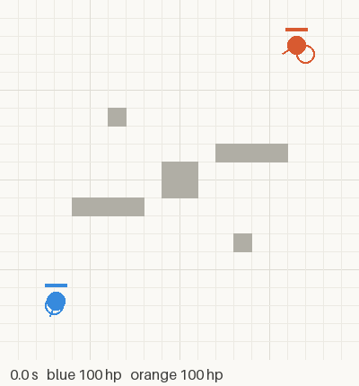
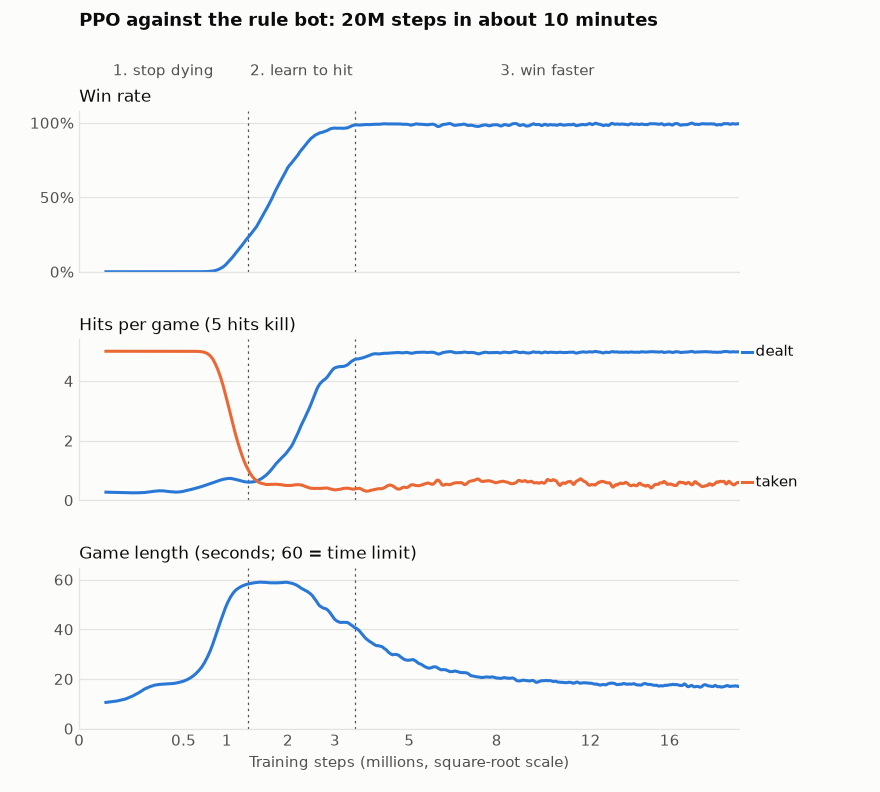
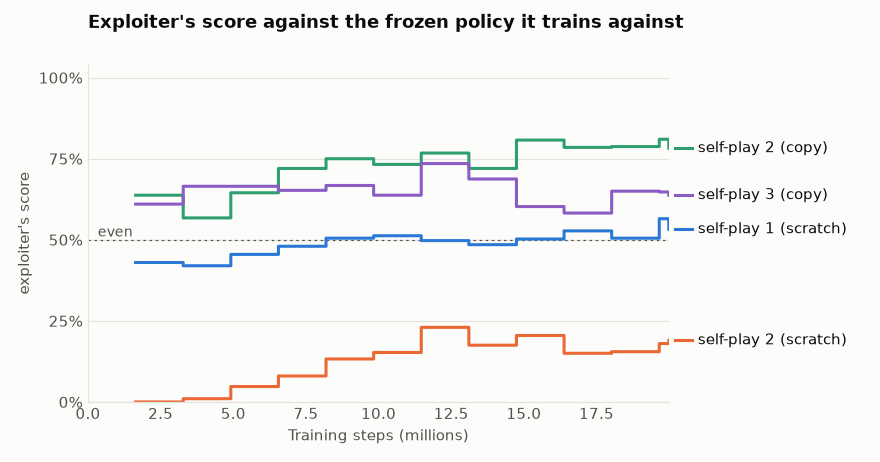
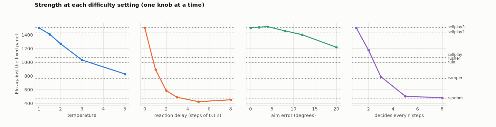
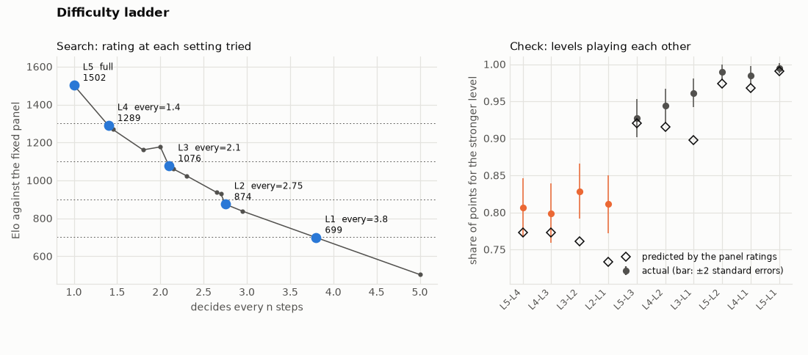
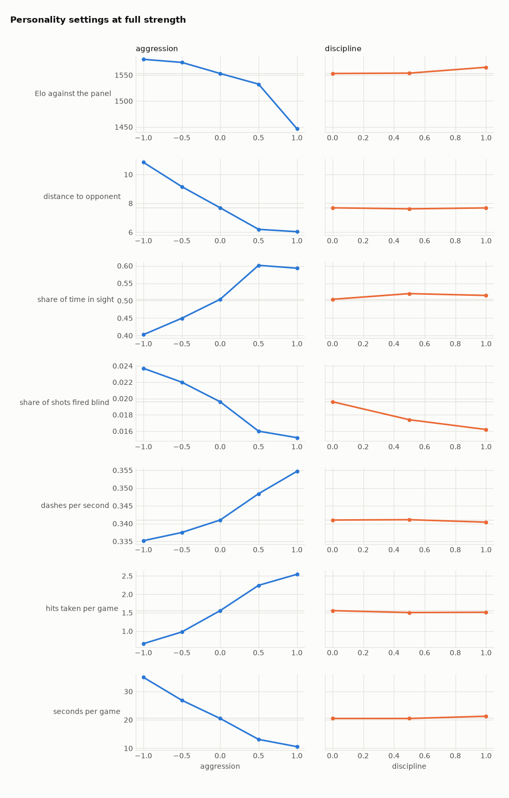
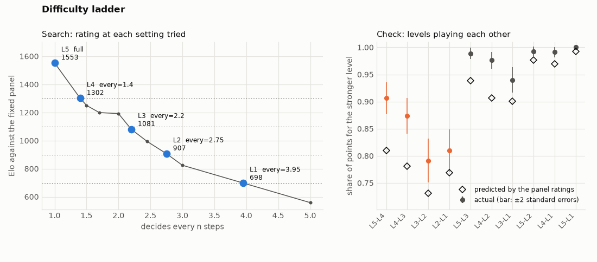

# ArenaMind

Training controllable, human-like NPCs for a 1v1 top-down shooter with
reinforcement learning: PPO from scratch, self-play, and deployment in Unity.



Status: the game environment (stage 0), PPO training against a rule-based
bot (stage 1), self-play (stage 2), and difficulty levels and personalities
(stage 3) are done. Running the policy in Unity comes next.

## The environment

* Two players, five pieces of cover, 60-second games, bullets with travel time
  and a dash for dodging. Rules, actions, observations and rewards are
  described in [docs/env_spec.md](docs/env_spec.md).
* Written in numpy and vectorised over games: about 250,000 game steps per
  second for 256 parallel games on one CPU core, or 65,000 including
  observations (`python -m tools.benchmark`).
* Each player gets a 49-number, egocentric observation with only what it
  could know (no seeing through cover). The opponent's last known position
  and the time since it was seen stand in for memory.
* Rewards are zero-sum: +-1 for the result plus +-0.2 per hit.
* Fairness is tested, not assumed: every game is replayed against its
  180-degree mirror image with the players swapped, and the results must be
  mirrored exactly.
* A rule-based bot (chase, aim, strafe, dodge) is the first opponent for
  training. It beats a random player 1000 games out of 1000 and splits games
  evenly against itself.

## Usage

```bash
pip install -r requirements.txt
python -m pytest                                   # tests
python -m tools.viewer --blue rule --orange random # watch two bots play
python -m tools.play --opponent rule               # play against the rule bot
python -m tools.play --record recordings/me.npz    # ...and save your games
python -m tools.replay --out runs/replay.gif       # record a game as a GIF
python -m tools.benchmark                          # simulation speed
python -m rl.league rule camper rusher kiter random # rate bots against each other (Elo)
python -m tools.viewer --blue "ppo:runs/style2/model.pt@every=2.2,aggression=1" --orange rule
                                                   # a trained policy at level L3, aggressive
```

Viewer keys: Space pause, Right arrow single step, Up/Down speed, R show rays.
Play keys: WASD or arrow keys move, mouse aim, click or Space shoot, Shift dash.

## Training (stage 1)

PPO written from scratch in PyTorch (`rl/`): separate actor and critic
networks, one action head per choice (move, turn, shoot, dash), GAE
advantages, clipped policy updates, an entropy bonus and learning-rate
annealing. 256 games run in parallel against the rule-based bot.

20 million steps took about 10 minutes (about 33,000 steps per second with
an RTX 5080).



The policy learned in three phases. First it stopped dying: hits taken fell
from 5 per game to under 1, and games ran into the 60-second limit. Then it
learned to hit back, and the win rate rose from 10% to 99% between 1 and 3.5
million steps. After that it kept winning, but faster: the average game went
from 59 to 17 seconds. Rewards are discounted by 1% per step (gamma = 0.99),
so a quick win is worth more than a slow one.

Results over 1000 games each (`python -m rl.evaluate`):

| Opponent | Policy plays | Win | Loss | Draw |
|---|---|---|---|---|
| rule bot | blue | 99.1% | 0.9% | 0% |
| rule bot | orange | 99.2% | 0.8% | 0% |
| idle bot (stands still, never shoots) | blue | 96.7% | 0% | 3.3% |
| idle bot, most likely action only (`--greedy`) | blue | 100% | 0% | 0% |

The policy was trained as blue only; the orange result shows that it can
play either side (see the observation notes in the spec). The idle bot checks
that it goes looking for an opponent that does not come to it. A draw there
means it never landed a hit in 60 seconds; this only happened with sampled
actions.


Install PyTorch for your machine first (see pytorch.org), then:

```bash
python -m rl.train --name first --steps 20000000   # progress in runs/first/log.csv
python -m rl.evaluate runs/first/model.pt --side orange --opponent rule
python -m tools.viewer --blue ppo:runs/first/model.pt --orange rule
python -m tools.play --opponent ppo-greedy:runs/first/model.pt
python -m tools.plot_training runs/first/log.csv   # curves like the ones above
```

`ppo:` samples actions from the policy; `ppo-greedy:` always takes the most
likely one.

## Self-play (stage 2)

### The problem: a policy that only knows one opponent

Beating the rule bot 99% of the time does not mean the stage-1 policy learned
to fight. To find out, four more bots aim and shoot exactly like the rule bot
but move differently. No training run ever uses them; they are a test set.

| Bot | Moves like this |
|---|---|
| camper | stays near its spawn point and waits |
| rusher | runs straight at the opponent and dashes to close in |
| kiter | keeps 10 to 14 units away and backs off when the opponent comes closer |
| flanker | swings out to the side and keeps circling the same way |

The stage-1 policy scored 14% against the camper and 35% against the rusher:
it had learned the rule bot's habits, not the game. The flanker was kept back
as a final exam. No policy played it until all training was done.

### Training against itself

`rl/selfplay.py` uses the same PPO as stage 1, but every game draws its
opponent from a pool when it starts:

* the rule bot (20% of games), so the basics are not forgotten;
* a frozen copy of the policy, refreshed every 10 iterations (50%);
* three older copies, picked at random from every snapshot saved so far (30%
  between them), so the policy keeps beating styles it has left behind.

Self-play only fixes the weaknesses that some copy of the policy happens to
exploit. So, as in AlphaStar's league, a separate *exploiter* is trained too:
a new policy whose only opponent is a frozen copy of the main policy. Its best
score measures how exploitable the main policy is, and the main policy then
gets the exploiter as an opponent, so that the weakness is trained away.

| Run | Opponents | Steps | Time |
|---|---|---|---|
| self-play 1 | the pool above, starting from scratch | 40M | 50 min |
| exploiter 1 | frozen self-play 1 only | 20M | 17 min |
| self-play 2 | continues self-play 1 with its 123 snapshots; exploiter 1 in 20% of games, rule bot 15%, latest copy 40%, older copies 25% | 30M | 44 min |
| exploiter 2 | frozen self-play 2 only | 20M | 16 min |
| exploiter 3 | frozen self-play 2 only, starting from self-play 2's weights | 20M | 15 min |
| self-play 3 | continues self-play 2 with all 215 earlier snapshots; exploiters 3 and 1 in 15% of games each, rule bot 15%, latest copy 35%, older copies 20% | 30M | 50 min |
| exploiter 4 | frozen self-play 3 only, starting from self-play 3's weights | 20M | 15 min |

Every 50 iterations the policy also plays 200 games against opponents that
never change (the rule bot and an earlier model). The pool keeps changing, so
its win rates cannot show progress; these scores can.

### Results

Score against each opponent (a win counts 1, a draw 1/2) over 400 games per
pair, 200 on each side, from one league (`python -m rl.league`):

| Opponent | Stage 1 | Self-play 1 | Self-play 2 |
|---|---|---|---|
| rule bot (in training) | 99% | 98% | 100% |
| kiter | 96% | 96% | 100% |
| camper | 14% | 78% | 97% |
| rusher | 35% | 35% | 84% |
| **flanker (final exam)** | **48%** | **95%** | **100%** |
| random | 97% | 100% | 100% |

Over 1000 games as blue (`python -m rl.evaluate`), self-play 2 won 99.3% of
its games against the flanker and all 1000 against the idle bot. The stage-1
policy won only 43.8% against the flanker, which the rule bot itself beats
about two games in three.

Elo ratings from the same league, with the rule bot pinned at 1000:

| Player | Elo |
|---|---|
| self-play 2 | 1505 |
| self-play 1 | 1219 |
| stage 1 | 1004 |
| rule bot | 1000 |
| rusher | 993 |
| kiter | 983 |
| flanker | 934 |
| camper | 851 |
| random | 458 |

How far each self-play policy could be exploited. An exploiter trained from
scratch spends most of its steps learning to play at all, so exploiters 3 and
4 start from a copy of the policy they attack: they begin at about 50%, and
anything above that is a real weakness. Final exploiters; the first two rows
are from 200-game evaluations, the last two from 1000 games in a league:

| Frozen policy | Exploiter starts from | Exploiter's score against it | Exploiter's score against the rule bot |
|---|---|---|---|
| self-play 1 | scratch (exploiter 1) | 53% | 13% |
| self-play 2 | scratch (exploiter 2) | 19% | 72.5% |
| self-play 2 | its weights (exploiter 3) | **79%** | 99% |
| self-play 3 | its weights (exploiter 4) | **62%** | 100% |



Exploiter 1 found a cheap trick: keep its distance, because self-play 1 did
not come after it. 68% of its games ended level at the 60-second limit (a
draw), and when it landed the first hit it kept away and won on HP. It scored
only 13% against the rule bot: no good as a fighter, only as a counter to one
opponent. Self-play 2 learned to punish the trick within 1.7 million steps:
its win rate against exploiter 1 went from 16% to 100%. Exploiter 2 found no
such shortcut. To score at all it had to learn to fight, which made it a
real fighter (72.5% against the rule bot), and it still never got above 23%.

That looked like strong evidence, but exploiter 2 was simply too weak to
find anything. Exploiter 3 had the same 20 million steps but started from
self-play 2's weights, and it beat self-play 2 79% of the time. The few
replays watched suggest how: it waits near its own spawn and shoots
self-play 2 as it charges across the map. It was not simply a better player,
though. Exploiter 1 scores 50% against it, and it beats the camper only 87%
of the time, where self-play 2 manages 100% and 95%. Specialising against one
opponent cost it what self-play 2 had learned against others, as in stage 1.

### Ablation: the exploiter, or just more training?

Self-play 2 differs from self-play 1 in two ways: exploiter 1 in its pool and
30 million more training steps. A third run, `selfplay2_noexp`, has the extra
steps but no exploiter. It has the same start, old snapshots and step count;
exploiter 1's 20% of games is shared out in the same proportions as the rest
(rule bot 18.75%, latest copy 50%, older copies 31.25%).

The test was fixed before the run. If exploiter 1 scores at least 20 points
more against the run without it than against self-play 2, the exploiter is
what removed the weakness. Within 8 points, extra training alone would have
done it.

| Score in one league (400 games per pair) | Self-play 1 | Self-play 2 without exploiter | Self-play 2 |
|---|---|---|---|
| exploiter 1 against it | 53% | **49%** | **0%** |
| it against the rusher | 35% | 62% | 84% |
| it against the camper | 79% | 96% | 96% |
| it against the flanker | 95% | 100% | 100% |
| it against the rule bot | 98% | 100% | 100% |

Extra training alone did nothing for the weakness that exploiter 1 found: it
still scores 49% against the run without it, within noise of its 53% against
self-play 1, and 0% against self-play 2. So the exploiter is what fixed it.
The gains against the camper and the flanker came from the extra training,
since both runs reach the same scores there. Self-play 2 also beat the rusher
far more often (84% against 62% here, and 80.9% against 64.7% over 1000 games
each with `rl.evaluate`), but with one run of each this could be down to
chance in training. More seeds are needed before it can be credited to the
exploiter. Head to head the two runs are even (53%).

### A second round

Self-play 3 continues self-play 2 with exploiters 3 and 1 as fixed opponents
(see the table of runs). The test was fixed before the run: exploiter 3 at
45% or less against self-play 3 means the weakness is gone, 55% or more means
it is not, and anything between means it is partly fixed. Nothing else may
get worse.

| | Self-play 2 | Self-play 3 |
|---|---|---|
| exploiter 3 against it (league, 1000 games) | 80% | **47%** |
| exploiter 1 against it | 0% | 0% |
| against the rule bot (1000 games as blue) | 99.8% | 99.6% |
| against the camper | 95.2% | 99.7% |
| against the rusher | 80.9% | 88.0% |
| against the kiter | 99.7% | 99.7% |
| against the flanker | 99.3% | 100% |
| head to head (league, 1000 games) | 41% | 59% |

Exploiter 3 fell from 80% to 47%. By the rule that counts as partly fixed,
although 47% is within noise of an even match. Nothing got worse, and the
rusher went from 80.9% to 88.0% (as the ablation showed, the extra training
may deserve part of that).

Exploiter 4 measures self-play 3 the way exploiter 3 measured self-play 2:
it starts from self-play 3's weights and trains for 20 million steps. It
reached 62%, down from 79%. The rule fixed in advance was that 65% or less
means the loop is converging, 75% or more that it is not. Like exploiter 3, it
gave up some of the policy's breadth (exploiter 1 scores 24% against it, and
it beats the camper 86% of the time). Two rounds are too few to call a trend,
but the measure moved in the right direction. Self-play 3 is the strongest
policy so far and the starting point for stage 3.

### What these numbers do not show

* The test bots share the rule bot's aim, so they test different movement,
  not different players. Human play is a harder test.
* The camper, rusher and kiter results were looked at while deciding what to
  train next, so only the flanker was truly unseen until the end.
* An exploiter's score is only a lower bound, and a weak exploiter can make a
  policy look far safer than it is: exploiter 2, trained from scratch, scored
  23% against self-play 2, while exploiter 3, started from its weights,
  scored 79%. Exploiter 4's 62% is a lower bound too.
* Every run was trained once, with one random seed, so it is unknown how much
  a second run would differ.
* Ratings from different leagues cannot be compared. Self-play 2 rates 1505
  in the league above and 1413 in the ablation league, which has exploiter 1
  in it and not the stage-1 policy.
* Matchups are not transitive. The rusher scores only 16% against the rule
  bot but 65% against the stage-1 policy and self-play 1. Elo squeezes this
  into one number per player, and the numbers depend on who is in the
  league.
* The rusher is still the hardest bot. Self-play 3 beats it 88.0% of the
  time; their games last 7.4 seconds on average and self-play 3 is hit 2.75
  times per game, against 1.24 times by the rule bot.

```bash
python -m rl.selfplay --name selfplay --steps 40000000 --reference runs/first/model.pt
python -m rl.selfplay --name exploiter1 --steps 20000000 --fixed runs/selfplay/model.pt --p-fixed 1 --p-rule 0 --p-latest 0 --reference runs/selfplay/model.pt
python -m rl.selfplay --name selfplay2 --steps 30000000 --init runs/selfplay/model.pt --seed-pool runs/selfplay/pool --fixed runs/exploiter1/model.pt --p-fixed 0.2 --p-rule 0.15 --p-latest 0.4 --reference runs/selfplay/model.pt
python -m rl.selfplay --name exploiter2 --steps 20000000 --fixed runs/selfplay2/model.pt --p-fixed 1 --p-rule 0 --p-latest 0 --reference runs/selfplay2/model.pt
python -m rl.selfplay --name exploiter3 --steps 20000000 --init runs/selfplay2/model.pt --fixed runs/selfplay2/model.pt --p-fixed 1 --p-rule 0 --p-latest 0 --reference runs/selfplay2/model.pt
python -m rl.selfplay --name selfplay3 --steps 30000000 --init runs/selfplay2/model.pt --seed-pool runs/selfplay/pool runs/selfplay2/pool --fixed runs/exploiter3/model.pt runs/exploiter1/model.pt --p-fixed 0.3 --p-rule 0.15 --p-latest 0.35 --reference runs/selfplay2/model.pt
python -m rl.selfplay --name exploiter4 --steps 20000000 --init runs/selfplay3/model.pt --fixed runs/selfplay3/model.pt --p-fixed 1 --p-rule 0 --p-latest 0 --reference runs/selfplay3/model.pt
python -m rl.selfplay --name selfplay2_noexp --steps 30000000 --init runs/selfplay/model.pt --seed-pool runs/selfplay/pool --p-rule 0.1875 --p-latest 0.5 --reference runs/selfplay/model.pt
python -m rl.evaluate runs/selfplay3/model.pt --opponent rule camper rusher kiter idle flanker
python -m rl.league rule kiter rusher camper flanker random ppo:runs/first/model.pt ppo:runs/selfplay/model.pt ppo:runs/selfplay2/model.pt
python -m rl.league rule camper rusher kiter flanker random ppo:runs/exploiter1/model.pt ppo:runs/selfplay/model.pt ppo:runs/selfplay2/model.pt ppo:runs/selfplay2_noexp/model.pt
python -m rl.league rule camper rusher kiter flanker ppo:runs/exploiter1/model.pt ppo:runs/exploiter3/model.pt ppo:runs/selfplay2/model.pt ppo:runs/selfplay3/model.pt --games 500
python -m rl.league ppo:runs/selfplay3/model.pt ppo:runs/exploiter4/model.pt rule rusher camper ppo:runs/exploiter1/model.pt --games 500
python -m tools.plot_logs "self-play 1 (scratch)=runs/exploiter1/log.csv:eval_reference" "self-play 2 (scratch)=runs/exploiter2/log.csv:eval_reference" "self-play 2 (copy)=runs/exploiter3/log.csv:eval_reference" "self-play 3 (copy)=runs/exploiter4/log.csv:eval_reference" --percent --mark 0.5:even
```

In a self-play log, `win_vs_rule`, `win_vs_latest`, `win_vs_past` and
`win_vs_fixed` are win rates against each kind of pool opponent, and
`eval_rule` and `eval_reference` are the scores against the fixed opponents.

## Difficulty levels (stage 3)

### The problem: one strength only

Self-play 3 takes 99.5% of the points against the rule bot, so most players
would never beat it. A game needs levels. Training a weaker model for each
level would cost about an hour per level, and a training run cannot be
aimed at a strength. Instead, the strongest policy is weakened while it
plays, with no retraining.

### Four knobs

Each step the policy observes, scores every action, samples one and acts.
`rl/difficulty.py` can change one link of that chain at a time:

| Knob | What it changes |
|---|---|
| `temp` | action scores are divided by a temperature before sampling |
| `delay` | the policy sees the observation from n steps (0.1 s each) ago, its own state included |
| `aim` | the opponent's position and velocity are seen turned by an angle error that drifts slowly (it changes over about 0.5 s) |
| `every` | the policy decides every n steps on average and repeats its last action in between; fractions mix the gaps (1.5 alternates 2 and 1) |

Settings follow the checkpoint wherever a bot is named, for example
`python -m tools.play --opponent ppo:runs/selfplay3/model.pt@every=2.1`.

### Measuring strength against a fixed panel

A league rates everyone at once, so adding a player moves the others
(self-play 2 rated 1505 in one league and 1413 in another). `rl/rate.py`
rates a panel of seven once, in a league among themselves (200 games per
pair and side, rule bot pinned at 1000), and saves the ratings. A new player
then plays 100 games on each side against every panel member and gets the
one rating under which its expected total score equals its actual one, with
the panel's ratings held fixed. The panel runs from weak to strong so that
every player has some opponents close to its own level:

| random | camper | rule bot | rusher | self-play 1 | self-play 2 | self-play 3 |
|---|---|---|---|---|---|---|
| 477 | 767 | 1000 | 1007 | 1071 | 1441 | 1513 |

Weaker should still look human, so the same games are also measured for
style: accuracy, reaction time (from the opponent coming into view to the
first shot), movement changes per second, turn reversals per second (turning
one way, then the other), and the share of shots fired while the opponent is
out of sight.

### Which knob?

Two tests were fixed before the sweep. A knob must take the rating below the
rule bot's 1000, falling level by level. At its level nearest 1000, turn
reversals may be at most 1.5 times full strength's, and the share of blind
shots at most 10 points higher.

| Knob and levels | Rating at each level (full strength 1502) | Level nearest 1000 | Turn reversals/s (full 3.70) | Blind shots (full 47.7%) |
|---|---|---|---|---|
| temp 1.5, 2, 3, 5 | 1409, 1271, 1033, 829 | temp 3: 1033 | 4.11 | 56.4% |
| delay 1, 2, 3, 5, 8 steps | 892, 586, 489, 424, 452 | delay 1: 892 | 2.97 | 48.3% |
| aim 2, 4, 8, 12, 20 degrees | 1513, 1521, 1459, 1403, 1219 | none; 20 degrees: 1219 | 3.71 | 43.8% |
| every 2, 3, 5, 8 | 1177, 791, 503, 481 | every 2: 1177 | 2.59 | 40.1% |



* `temp` passes, narrowly, by making the policy erratic: at temperature 3 it
  changes direction 35% more often, fires 56% of its shots blind and hits
  6.6% of them, against 9.0% at full strength.
* `delay` fails. A tenth of a second costs 610 points, and from 3 steps on
  the policy is no better than the random bot (8 rates 27 points above 5,
  within the noise of about 15 points per rating). The likely reason is that
  it never saw a stale observation in training: it sees its own heading late
  too, so it turns past the target and back.
* `aim` fails: 12 degrees of error cost about 100 points. At full strength
  the policy hits only 9% of its shots anyway, so aiming worse changes
  little. Its style does not change at all.
* `every` passes both tests, and it weakens the policy the way a slower
  player is weaker. Reaction time goes from 0.22 s to 0.25, 0.29 and 0.34 s
  at every 2, 3 and 5, and movement changes drop from 5.7 to 3.1 per second
  at every 2. Accuracy stays between 8.4% and 10.4% up to every 3.8 and
  only falls beyond that (4.2% at every 5).

### A difficulty ladder

`tools/difficulty_ladder.py` turns `every` until the rating is within 25
points of each target. It rates the two ends of the range, then repeatedly
tries the level where a straight line between the nearest settings on
either side of the target crosses it. Levels are rounded to 0.05, and every
rating is kept for the later targets. 14 settings were rated, in about
8 minutes. Rating full strength, every 2 and every 5 again with the same
seeds gave the sweep's ratings to the decimal.

| Level | every | Target | Rating | Reaction | Turn reversals/s | Blind shots | Accuracy | Score against the rule bot |
|---|---|---|---|---|---|---|---|---|
| L5 | 1 (full strength) | | 1502 | 0.22 s | 3.70 | 47.7% | 9.0% | 99.5% |
| L4 | 1.4 | 1300 | 1289 | 0.24 s | 2.83 | 42.8% | 9.3% | 98.5% |
| L3 | 2.1 | 1100 | 1076 | 0.26 s | 2.50 | 39.5% | 9.4% | 88.5% |
| L2 | 2.75 | 900 | 875 | 0.28 s | 2.18 | 41.0% | 9.0% | 55.8% |
| L1 | 3.8 | 700 | 699 | 0.32 s | 1.89 | 39.4% | 8.4% | 17.0% |

L2 missed its target by 25.5 points: the rating falls 55 points between
every 2.7 (929) and 2.75 (875), one step apart. The levels are saved in
`runs/ladder/ladder.json` for the Unity build.

### Checking the ladder

The levels then played each other, 400 games per pair. If the panel ratings
are right, each pair's score follows from its rating gap. The test, set
before the run, was that neighbouring levels land within two standard errors
of the prediction:

| Pair | Rating gap | Predicted | Actual |
|---|---|---|---|
| L5 against L4 | 213 | 77.3% | 80.6% +- 4.0 |
| L4 against L3 | 213 | 77.3% | 79.9% +- 4.0 |
| L3 against L2 | 202 | 76.1% | 82.9% +- 3.8 |
| L2 against L1 | 176 | 73.3% | 81.1% +- 3.9 |



Two of the four pairs pass. The order holds in all ten pairs (every level
beats every level below it), but every pair's actual score is at or above
its prediction: among themselves the levels are about 240 to 275 points
apart, not 200. A single rating is an average over the panel and hides
matchups. L2's rating predicts 65% against the camper and 33% against the
rule bot; it scores 37% and 56%.

### What these numbers do not show

* The panel is seven bots and policies, not people. Whether L1 to L5 feel
  evenly spaced to players is untested until the game runs in Unity.
* Each rating comes from 1400 games and carries about 12 to 18 points of
  noise. Each setting was rated once.
* Full strength itself fires almost half of its shots blind and hits 9% of
  them. The knobs make it slower, not more human in that respect.
* `delay` was only tried on a policy trained without delays. A policy
  trained with random delays might cope with them.

```bash
python -m rl.rate ppo:runs/selfplay3/model.pt ppo:runs/selfplay3/model.pt@every=2   # rate against the panel
python -m tools.difficulty_sweep runs/selfplay3/model.pt                            # one knob at a time
python -m tools.difficulty_ladder runs/selfplay3/model.pt                           # targets 1300 1100 900 700
```

The panel's ratings are saved in `runs/panel.json` and reused; delete the
file to rate the panel again.

## Personalities (stage 3)

### The problem: one way of playing

Difficulty changes how well the policy plays. A game also wants to change
how it plays: an aggressive opponent that pushes, a careful one that keeps
its distance, a disciplined one that waits for a clear shot. The same games
are therefore also measured for the distance to the opponent, the share of
time the two can see each other, shots and dashes per second, hits taken per
game and the length of a game (`rl/rate.py`).

### Without training: shifting action scores

`rl/personality.py` adds fixed amounts to some action scores before one is
drawn. Adding 1 makes that action e (2.7) times as likely against the others.

| Setting | What it shifts |
|---|---|
| `approach` | each movement direction, in proportion to how much it heads towards the opponent's last known position (negative: away) |
| `hold` | shooting, down, while the opponent is out of sight |
| `dash` | dashing |

The tests, fixed before the run: within 100 rating points of full strength,
`approach` must make the distance at least 15% shorter one way and 15% longer
the other, `hold` must halve the share of blind shots, and `dash` must double
or halve the dashes. Self-play 3, rated against the panel:

| Setting | Rating | Distance | Blind shots | Hits taken per game | Game length |
|---|---|---|---|---|---|
| own play | 1502 | 8.5 | 47.7% | 1.70 | 21.4 s |
| `approach=-1.5` | 1472 | 12.6 | 58.1% | 1.29 | 31.0 s |
| `approach=+1.5` | 1464 | 8.2 | 47.2% | 2.17 | 17.6 s |
| `approach=+3` | 1386 | 8.3 | 48.5% | 2.58 | 14.1 s |
| `hold=4` | 1528 | 8.5 | 6.5% | 1.71 | 21.1 s |
| `hold=8` | 1501 | 8.5 | 0.1% | 1.66 | 21.6 s |
| `dash=-3` | 1499 | 8.4 | 46.2% | 1.86 | 21.1 s |

* `hold` passes, and costs nothing. Almost half of self-play 3's shots were
  wasted: without them accuracy goes from 9.0% to 15.1% and the first shot
  after the opponent appears comes 0.14 s after it, not 0.22 s, because the
  gun is not cooling down from a blind shot. Training gave shots no cost, so
  the policy fired whenever it could.
* `approach` fails. Negative values keep the policy away, but positive ones
  do not bring it closer: games get shorter and it takes more hits, so it
  trades hits faster rather than standing nearer. At -3 it hides so much that
  it scores only 64% against the random bot.
* `dash` fails: the policy already dashes about as often as the cooldown
  allows (0.34 per second), so there is no room upwards, and -3 cuts dashes
  by a third.

### Training with personality sliders

`rl/style.py` gives the policy two more inputs, aggression (-1 careful to +1
aggressive) and discipline (0 to 1), and the learner's reward extra terms
that depend on them:

| Slider | Extra reward per step |
|---|---|
| aggression a > 0 | + a x 0.2 per hit landed, - a x 0.001 per step the game goes on |
| aggression a < 0 | - abs(a) x 0.3 per hit taken |
| discipline d | - d x 0.02 per shot fired while the opponent is out of sight |

The game's own reward stays, so every setting still plays to win. Every game
draws both sliders, for the learner and for its opponent, when it starts. One
network learns every setting, because the sliders tell it which reward it is
playing for. Training starts from self-play 3: the new inputs get zero
weights (`widen_inputs` in `rl/model.py`), so the starting policy plays
exactly like self-play 3, and older snapshots and exploiters in the pool are
widened the same way. The pool is self-play 3's, with exploiter 4 added as a
fixed opponent.

The tests, fixed before training: rated 1400 or more, aggression must make
games at least 25% shorter at some positive setting and the distance at
least 30% longer at some negative one, and discipline must bring blind shots
below 10%. Round 1 used the rewards above. Round 2 multiplied them by 3
(`--style-scale 3`), with everything else the same, and was declared the last
round before it ran.

| Aggression | Round 1 rating | Game length | Distance | Round 2 rating | Game length | Distance | Hits taken |
|---|---|---|---|---|---|---|---|
| -1 | 1597 | 24.6 s | 9.0 | 1580 | 35.0 s | 10.8 | 0.66 |
| -0.5 | 1575 | 22.5 s | 8.6 | 1575 | 26.9 s | 9.2 | 0.98 |
| 0 | 1590 | 19.6 s | 7.9 | 1553 | 20.5 s | 7.7 | 1.56 |
| +0.5 | 1579 | 17.6 s | 7.3 | 1533 | 13.1 s | 6.2 | 2.24 |
| +1 | 1545 | 15.3 s | 6.9 | 1447 | 10.6 s | 6.0 | 2.54 |



* Round 1 fails: games 22% shorter and distance 14% longer at the ends. Round
  2 passes: 36% and 48% shorter games at +0.5 and +1, 41% more distance at -1,
  every setting above 1400.
* Trained personalities are much stronger than shifted scores for the same
  change in play: 36% shorter games cost the shifted self-play 3 down to 1386
  (`approach=+3`) and leave the trained policy at 1533 (+0.5); 41-48% more
  distance gives 1472 shifted (`approach=-1.5`) and 1580 trained (-1).
* Careful play is the strongest setting in both rounds (1597 and 1580).
  Taking fewer hits is simply better play here.
* Discipline passes its test but does nothing: blind shots are at 2% with the
  slider at 0 too (9% in round 1). Blind shots never helped, and most games in
  training penalised them, so the policy stopped firing blind altogether.
* Larger rewards cost the neutral setting 37 points (1590 to 1553; it scores
  51% against self-play 3, against 58% in round 1). Round 2 is kept: it is
  the only one whose sliders change play as much as asked.

### The final ladder, with personalities

The ladder was calibrated again on the round 2 policy (sliders at 0), and each
level was then rated with each extreme of aggression
(`tools/difficulty_ladder.py --also`):

| Level | every | Rating | Careful (-1) | Aggressive (+1) | Reaction | Blind shots | Accuracy |
|---|---|---|---|---|---|---|---|
| L5 | 1 | 1553 | 1580 | 1447 | 0.14 s | 2.0% | 15.9% |
| L4 | 1.4 | 1302 | 1413 | 1167 | 0.17 s | 2.2% | 14.9% |
| L3 | 2.2 | 1081 | 1102 | 944 | 0.20 s | 2.6% | 14.7% |
| L2 | 2.75 | 907 | 937 | 788 | 0.24 s | 3.2% | 14.8% |
| L1 | 3.95 | 698 | 648 | 662 | 0.28 s | 2.5% | 12.6% |



* Personality survives every level: the careful setting keeps 10.8 to 11.8
  units away and plays 24 to 36 s games at every level, the aggressive one
  6.0 to 6.8 units and about 11 s.
* It also moves strength. Aggressive levels are 36 to 137 points weaker, so a
  game that wants both to be equally hard has to calibrate each personality
  on its own.
* Against the first ladder (on self-play 3), every level now fires 2-3% of
  its shots blind instead of 39-48%, and hits 13-16% instead of 8-9%.
* The levels again keep their order in every pair, and again play each other
  more one-sidedly than their ratings predict, more so than before: L5 takes
  90.6% against L4 (predicted 81.0%), and none of the four neighbouring pairs
  lands within two standard errors of its prediction.

### What these numbers do not show

* Each round was trained once, with one seed. Round 2 was chosen after
  seeing round 1; the tests stayed the same.
* Personality is measured with game statistics, not by asking players
  whether an opponent feels aggressive or careful.
* The levels are calibrated for the neutral setting only.

```bash
python -m tools.personality_sweep runs/selfplay3/model.pt                  # shifted scores
python -m rl.selfplay --name style2 --style --style-scale 3 --steps 30000000 --init runs/selfplay3/model.pt --seed-pool runs/selfplay/pool runs/selfplay2/pool runs/selfplay3/pool --fixed runs/exploiter3/model.pt runs/exploiter1/model.pt runs/exploiter4/model.pt --p-fixed 0.3 --p-rule 0.15 --p-latest 0.35 --reference runs/selfplay3/model.pt
python -m tools.personality_sweep runs/style2/model.pt --traits aggression discipline --out runs/style2_sweep
python -m tools.difficulty_ladder runs/style2/model.pt --out runs/ladder2 --also aggression=-1 aggression=1
```

Round 1 is the same training command without `--style-scale` (`--name style`).

## Layout

```
arena/      game: config, geometry, env (simulation), obs, bots, render
rl/         PPO: model, GAE, training loop, self-play, evaluation, Elo league, policy as a bot,
            difficulty and personality settings, personality sliders, rating against a fixed panel
tools/      viewer, play, replay, benchmark, training plots, difficulty and personality sweeps, ladder
tests/      unit tests and whole-game checks
docs/       environment spec, training curves, result charts
```
