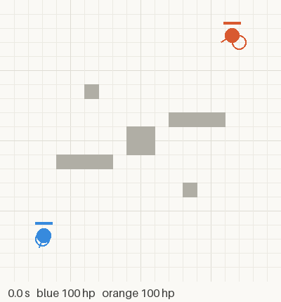
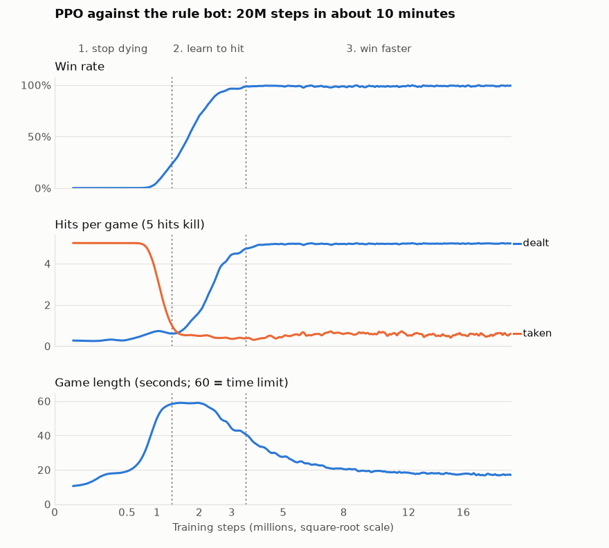
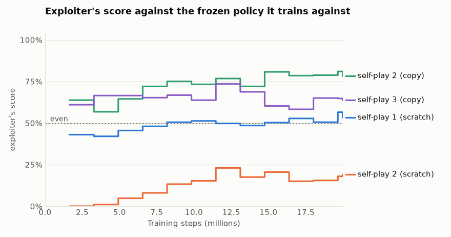
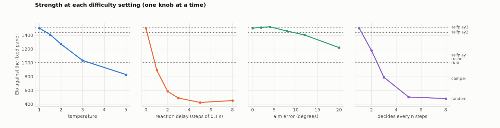
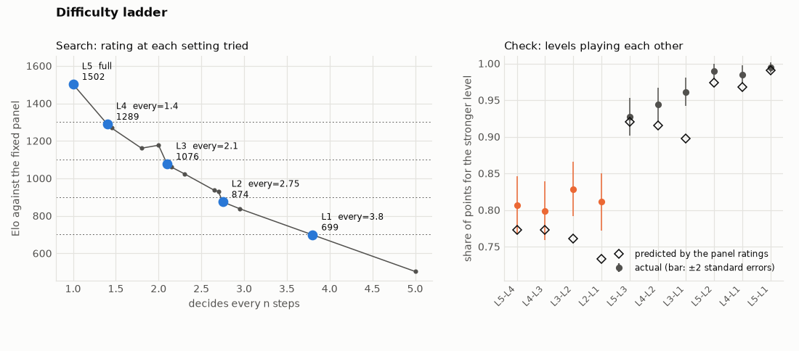
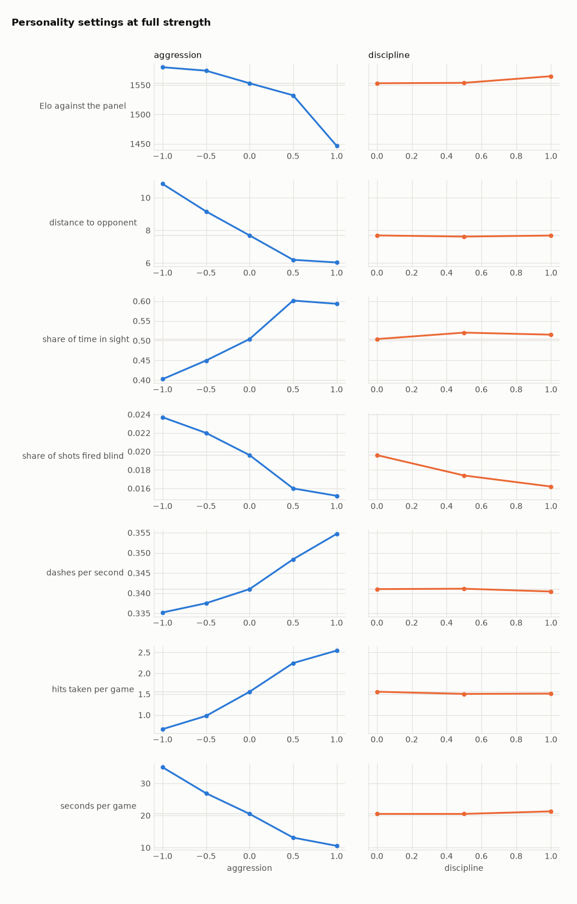
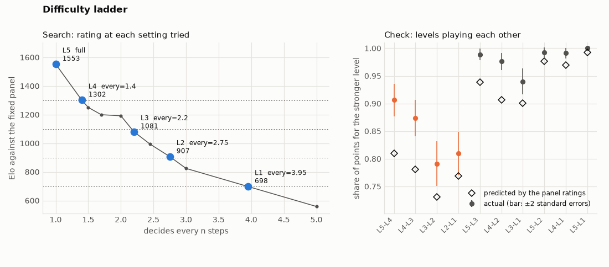
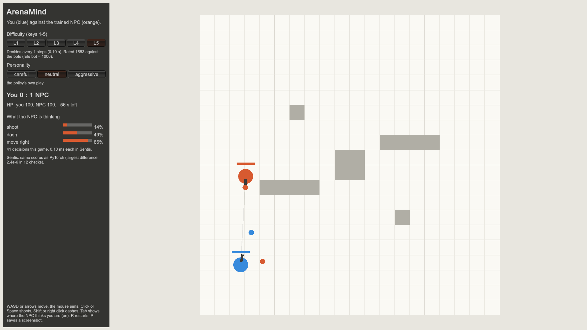

# ArenaMind

[English](README.md) | 中文

为一个 1v1 俯视角射击游戏训练可控、像人的 NPC，用的是强化学习：从零实现的
PPO、自博弈，以及部署到 Unity。



进度：游戏环境（阶段 0）、对规则 bot 的 PPO 训练（阶段 1）、自博弈（阶段 2）、
难度档位与性格（阶段 3）、把训练好的 NPC 放进 Unity（阶段 4）已经完成。下一步是
从真人对局中学习。

## 游戏环境

* 两名玩家、五块掩体、每局 60 秒，子弹有飞行时间，还有用来躲避的冲刺。规则、
  动作、观测和奖励写在 [docs/env_spec.md](docs/env_spec.md)。
* 用 numpy 写成，按对局向量化：单个 CPU 核心上 256 局并行，每秒约 25 万步；
  算上观测是每秒 6.5 万步（`python -m tools.benchmark`）。
* 每名玩家拿到 49 个数的自我中心观测，只包含它本来能知道的信息（看不穿掩体）。
  对手最后出现的位置和距今多久，代替了记忆。
* 奖励是零和的：胜负 ±1，每次命中 ±0.2。
* 公平性是测出来的，不是假设的：每一局都和它旋转 180 度、交换双方之后的镜像局
  对照重放，结果必须完全镜像。
* 第一个训练对手是手写规则的 bot（追击、瞄准、横移、躲避）。它对随机玩家
  1000 局全胜，自己打自己各赢一半。

## 用法

```bash
pip install -r requirements.txt
python -m pytest                                   # tests
python -m tools.viewer --blue rule --orange random # watch two bots play
python -m tools.play --opponent rule               # play against the rule bot
python -m tools.play --record recordings/me.npz    # ...and save your games
python -m tools.replay --out runs/replay.gif       # record a game as a GIF
python -m tools.benchmark                          # simulation speed
python -m rl.league rule camper rusher kiter random # rate bots against each other (Elo)
python -m tools.viewer --blue "ppo:runs/style2/model.pt@every=2.2,aggression=1" --orange rule
                                                   # a trained policy at level L3, aggressive
```

观战按键：空格暂停，右方向键单步，上下方向键调速度，R 显示射线。
对战按键：WASD 或方向键移动，鼠标瞄准，左键或空格射击，Shift 冲刺。

要在 Unity 里和训练好的 NPC 对战，用 Unity 6（6000.0）打开 `unity/`，在任意场景
按 Play 即可（见下文“在 Unity 里（阶段 4）”）。

## 训练（阶段 1）

在 PyTorch 里从零写的 PPO（`rl/`）：actor 和 critic 是两个独立网络，每种选择
（移动、转向、射击、冲刺）各一个动作头，用 GAE 估计优势，策略更新带裁剪，
加熵奖励，学习率逐步衰减。256 局同时对规则 bot 进行。

2000 万步用了大约 10 分钟（RTX 5080，约每秒 3.3 万步）。



策略分三个阶段学会。先是不再送死：每局被打中次数从 5 次降到 1 次以下，对局
常常打满 60 秒。然后学会还手：在 100 万到 350 万步之间，胜率从 10% 升到 99%。
之后它继续赢，但赢得更快：平均每局从 59 秒缩短到 17 秒。奖励每步打 1% 的折扣
（gamma = 0.99），所以快赢比慢赢更值。

各 1000 局的结果（`python -m rl.evaluate`）：

| 对手 | 策略执 | 胜 | 负 | 平 |
|---|---|---|---|---|
| 规则 bot | 蓝方 | 99.1% | 0.9% | 0% |
| 规则 bot | 橙方 | 99.2% | 0.8% | 0% |
| 站桩 bot（不动、不开枪） | 蓝方 | 96.7% | 0% | 3.3% |
| 站桩 bot，只取最可能的动作（`--greedy`） | 蓝方 | 100% | 0% | 0% |

策略只以蓝方身份训练过；橙方的结果说明它两边都能打（见规格说明里关于观测的
部分）。站桩 bot 用来检查它会不会主动去找不过来的对手。那里的平局意思是 60 秒
内一枪没打中；这只在按概率抽动作时出现。


先按你的机器装好 PyTorch（见 pytorch.org），然后：

```bash
python -m rl.train --name first --steps 20000000   # progress in runs/first/log.csv
python -m rl.evaluate runs/first/model.pt --side orange --opponent rule
python -m tools.viewer --blue ppo:runs/first/model.pt --orange rule
python -m tools.play --opponent ppo-greedy:runs/first/model.pt
python -m tools.plot_training runs/first/log.csv   # curves like the ones above
```

`ppo:` 按策略的概率抽动作；`ppo-greedy:` 总是取最可能的那个。

## 自博弈（阶段 2）

### 问题：只认识一种对手的策略

对规则 bot 赢 99% 不代表阶段 1 的策略学会了打架。为了弄清楚，另外做了四个 bot：
瞄准和开枪与规则 bot 完全相同，只是移动方式不同。任何一次训练都不用它们，它们是
测试集。

| Bot | 移动方式 |
|---|---|
| camper（蹲点） | 待在出生点附近等 |
| rusher（冲锋） | 直冲对手，用冲刺拉近距离 |
| kiter（风筝） | 保持 10 到 14 个单位的距离，对手靠近就后退 |
| flanker（包抄） | 向侧面绕出去，一直朝同一方向转圈 |

阶段 1 的策略对蹲点只拿到 14% 的分，对冲锋 35%：它学会的是规则 bot 的习惯，
不是这个游戏。包抄留作期末考试，所有训练结束之前没有任何策略和它打过。

### 和自己对练

`rl/selfplay.py` 用的是和阶段 1 一样的 PPO，但每局开始时从对手池里抽一个对手：

* 规则 bot（20% 的对局），免得忘了基本功；
* 策略自己的冻结副本，每 10 轮更新一次（50%）；
* 三个更旧的副本，从至今保存的所有快照里随机挑（合计 30%），让策略继续打得过
  它已经甩在身后的打法。

自博弈只能修补策略的某个副本碰巧会利用的弱点。所以像 AlphaStar 的联赛一样，
还单独训练一个挑战者（exploiter）：一个新策略，唯一的对手是主策略的冻结副本。
它的最高得分衡量主策略有多容易被针对；之后把挑战者放进主策略的对手池，把这个
弱点练掉。

| 训练 | 对手 | 步数 | 用时 |
|---|---|---|---|
| 自博弈 1 | 上面的对手池，从零开始 | 4000 万 | 50 分钟 |
| 挑战者 1 | 只有冻结的自博弈 1 | 2000 万 | 17 分钟 |
| 自博弈 2 | 接着自博弈 1 和它的 123 个快照练；挑战者 1 占 20% 的对局，规则 bot 15%，最新副本 40%，旧副本 25% | 3000 万 | 44 分钟 |
| 挑战者 2 | 只有冻结的自博弈 2 | 2000 万 | 16 分钟 |
| 挑战者 3 | 只有冻结的自博弈 2，从自博弈 2 的权重出发 | 2000 万 | 15 分钟 |
| 自博弈 3 | 接着自博弈 2 和之前全部 215 个快照练；挑战者 3 和 1 各占 15%，规则 bot 15%，最新副本 35%，旧副本 20% | 3000 万 | 50 分钟 |
| 挑战者 4 | 只有冻结的自博弈 3，从自博弈 3 的权重出发 | 2000 万 | 15 分钟 |

每 50 轮，策略还要和两个永远不变的对手（规则 bot 和一个早先的模型）打 200 局。
对手池一直在变，池里的胜率显示不出进步；这两个分数可以。

### 结果

对每个对手的得分（赢 1 分，平 0.5 分），每对 400 局、双方各执 200 局，来自同一次
联赛（`python -m rl.league`）：

| 对手 | 阶段 1 | 自博弈 1 | 自博弈 2 |
|---|---|---|---|
| 规则 bot（训练中见过） | 99% | 98% | 100% |
| 风筝 | 96% | 96% | 100% |
| 蹲点 | 14% | 78% | 97% |
| 冲锋 | 35% | 35% | 84% |
| **包抄（期末考试）** | **48%** | **95%** | **100%** |
| 随机 | 97% | 100% | 100% |

以蓝方各打 1000 局（`python -m rl.evaluate`），自博弈 2 对包抄赢了 99.3%，对站桩
1000 局全胜。阶段 1 的策略对包抄只赢 43.8%，而规则 bot 自己对包抄大约三局赢两局。

同一次联赛的 Elo 等级分，规则 bot 固定为 1000：

| 选手 | Elo |
|---|---|
| 自博弈 2 | 1505 |
| 自博弈 1 | 1219 |
| 阶段 1 | 1004 |
| 规则 bot | 1000 |
| 冲锋 | 993 |
| 风筝 | 983 |
| 包抄 | 934 |
| 蹲点 | 851 |
| 随机 | 458 |

每个自博弈策略能被针对到什么程度。从零开始的挑战者把大部分步数花在学会打游戏上，
所以挑战者 3 和 4 从它们要攻击的策略的副本出发：起点约 50%，超出的部分才是真正
的弱点。以下是训练结束时的挑战者；前两行来自 200 局评估，后两行来自联赛里的
1000 局：

| 被冻结的策略 | 挑战者的起点 | 挑战者对它的得分 | 挑战者对规则 bot 的得分 |
|---|---|---|---|
| 自博弈 1 | 从零开始（挑战者 1） | 53% | 13% |
| 自博弈 2 | 从零开始（挑战者 2） | 19% | 72.5% |
| 自博弈 2 | 它的权重（挑战者 3） | **79%** | 99% |
| 自博弈 3 | 它的权重（挑战者 4） | **62%** | 100% |



挑战者 1 找到了一个取巧的办法：保持距离，因为自博弈 1 不会追过来。它 68% 的对局
打到 60 秒时间到、双方血量相同（平局）；一旦先打中一枪，它就躲远、靠血量赢。它对
规则 bot 只拿 13%：作为战士不合格，只是专克一个对手。自博弈 2 在 170 万步内学会
了惩罚这一招：它对挑战者 1 的胜率从 16% 升到 100%。挑战者 2 没找到这样的捷径。
为了拿分它不得不学会打架，于是成了一个真正的战士（对规则 bot 72.5%），但它对自博弈
2 的得分始终没超过 23%。

这看起来是很强的证据，但其实只是挑战者 2 太弱、什么也找不到。挑战者 3 同样练了
2000 万步，但从自博弈 2 的权重出发，结果 79% 的时候打赢了自博弈 2。看过的几段
回放显示了它的打法：守在自己出生点附近，等自博弈 2 冲过地图时开枪。不过它并不是
单纯更强的选手：挑战者 1 对它能拿 50%，它对蹲点也只赢 87%，而自博弈 2 在这两项
分别是 100% 和 95%。专门针对一个对手，让它丢掉了自博弈 2 对付其他对手学到的东西，
和阶段 1 一样。

### 消融实验：是挑战者，还是只是多练了？

自博弈 2 和自博弈 1 有两处不同：对手池里有挑战者 1，以及多练了 3000 万步。第三次
训练 `selfplay2_noexp` 有多出来的步数，但没有挑战者。起点、旧快照和步数都相同；
挑战者 1 原来那 20% 的对局按其余对手的比例分掉（规则 bot 18.75%，最新副本 50%，
旧副本 31.25%）。

判断标准在开跑之前就定好了：如果挑战者 1 对“没有挑战者的版本”的得分，比对自博弈 2
高出至少 20 个百分点，说明是挑战者消除了这个弱点；如果相差在 8 个百分点以内，说明
光靠多练就够了。

| 同一次联赛的得分（每对 400 局） | 自博弈 1 | 没有挑战者的自博弈 2 | 自博弈 2 |
|---|---|---|---|
| 挑战者 1 对它 | 53% | **49%** | **0%** |
| 它对冲锋 | 35% | 62% | 84% |
| 它对蹲点 | 79% | 96% | 96% |
| 它对包抄 | 95% | 100% | 100% |
| 它对规则 bot | 98% | 100% | 100% |

光是多练，对挑战者 1 发现的弱点毫无作用：挑战者 1 对没有挑战者的版本仍拿 49%，
和它对自博弈 1 的 53% 在噪声范围内；而对自博弈 2 是 0%。所以修好它的是挑战者。
对蹲点和包抄的进步来自多练，因为两个版本在这两项上分数相同。自博弈 2 对冲锋也赢
得多得多（这里是 84% 对 62%，用 `rl.evaluate` 各打 1000 局是 80.9% 对 64.7%），
但每种设置只训练了一次，这可能是训练中的偶然。要归功于挑战者，还需要更多随机种子。
两者直接对打各一半（53%）。

### 第二轮

自博弈 3 接着自博弈 2 练，把挑战者 3 和 1 作为固定对手（见上面的训练表）。判断标准
在开跑之前定好：挑战者 3 对自博弈 3 的得分不超过 45% 说明弱点消除了，至少 55%
说明没有，中间算部分修复。其他任何一项都不能变差。

| | 自博弈 2 | 自博弈 3 |
|---|---|---|
| 挑战者 3 对它（联赛，1000 局） | 80% | **47%** |
| 挑战者 1 对它 | 0% | 0% |
| 对规则 bot（以蓝方打 1000 局） | 99.8% | 99.6% |
| 对蹲点 | 95.2% | 99.7% |
| 对冲锋 | 80.9% | 88.0% |
| 对风筝 | 99.7% | 99.7% |
| 对包抄 | 99.3% | 100% |
| 两者直接对打（联赛，1000 局） | 41% | 59% |

挑战者 3 从 80% 降到 47%。按规则这算部分修复，尽管 47% 和五五开在噪声范围内。
没有任何一项变差，对冲锋从 80.9% 升到 88.0%（消融实验说明，其中一部分可能要归功于
多练）。

挑战者 4 用衡量自博弈 2 的同样方法衡量自博弈 3：从自博弈 3 的权重出发，练 2000 万步。
它达到 62%，比 79% 低。事先定的规则是：不超过 65% 说明这个循环在收敛，至少 75% 说明
没有。和挑战者 3 一样，它也丢掉了一部分策略原有的广度（挑战者 1 对它拿 24%，它对蹲点
只赢 86%）。两轮太少，还谈不上趋势，但这个指标在往对的方向走。自博弈 3 是目前最强的
策略，也是阶段 3 的起点。

### 这些数字说明不了什么

* 测试用的 bot 瞄准方式和规则 bot 相同，所以测的是不同的移动方式，不是不同的选手。
  真人对局是更难的考验。
* 决定下一步练什么的时候看过蹲点、冲锋和风筝的结果，所以直到最后真正没见过的只有包抄。
* 挑战者的得分只是下限，弱的挑战者会让策略看起来比实际安全得多：从零开始的挑战者 2
  对自博弈 2 只拿 23%，而从它的权重出发的挑战者 3 拿到 79%。挑战者 4 的 62% 同样
  只是下限。
* 每次训练都只跑了一次、一个随机种子，不知道再跑一次会差多少。
* 不同联赛的等级分不能互相比较。自博弈 2 在上面的联赛里是 1505，在消融实验的联赛里
  是 1413，那次联赛里有挑战者 1，没有阶段 1 的策略。
* 对局关系不满足传递性。冲锋对规则 bot 只拿 16%，对阶段 1 的策略和自博弈 1 却能拿
  65%。Elo 把这些压缩成每个选手一个数，而这个数取决于联赛里有谁。
* 冲锋仍然是最难对付的 bot。自博弈 3 对它赢 88.0%；它们的对局平均只有 7.4 秒，
  自博弈 3 每局被打中 2.75 次，规则 bot 打它时是 1.24 次。

```bash
python -m rl.selfplay --name selfplay --steps 40000000 --reference runs/first/model.pt
python -m rl.selfplay --name exploiter1 --steps 20000000 --fixed runs/selfplay/model.pt --p-fixed 1 --p-rule 0 --p-latest 0 --reference runs/selfplay/model.pt
python -m rl.selfplay --name selfplay2 --steps 30000000 --init runs/selfplay/model.pt --seed-pool runs/selfplay/pool --fixed runs/exploiter1/model.pt --p-fixed 0.2 --p-rule 0.15 --p-latest 0.4 --reference runs/selfplay/model.pt
python -m rl.selfplay --name exploiter2 --steps 20000000 --fixed runs/selfplay2/model.pt --p-fixed 1 --p-rule 0 --p-latest 0 --reference runs/selfplay2/model.pt
python -m rl.selfplay --name exploiter3 --steps 20000000 --init runs/selfplay2/model.pt --fixed runs/selfplay2/model.pt --p-fixed 1 --p-rule 0 --p-latest 0 --reference runs/selfplay2/model.pt
python -m rl.selfplay --name selfplay3 --steps 30000000 --init runs/selfplay2/model.pt --seed-pool runs/selfplay/pool runs/selfplay2/pool --fixed runs/exploiter3/model.pt runs/exploiter1/model.pt --p-fixed 0.3 --p-rule 0.15 --p-latest 0.35 --reference runs/selfplay2/model.pt
python -m rl.selfplay --name exploiter4 --steps 20000000 --init runs/selfplay3/model.pt --fixed runs/selfplay3/model.pt --p-fixed 1 --p-rule 0 --p-latest 0 --reference runs/selfplay3/model.pt
python -m rl.selfplay --name selfplay2_noexp --steps 30000000 --init runs/selfplay/model.pt --seed-pool runs/selfplay/pool --p-rule 0.1875 --p-latest 0.5 --reference runs/selfplay/model.pt
python -m rl.evaluate runs/selfplay3/model.pt --opponent rule camper rusher kiter idle flanker
python -m rl.league rule kiter rusher camper flanker random ppo:runs/first/model.pt ppo:runs/selfplay/model.pt ppo:runs/selfplay2/model.pt
python -m rl.league rule camper rusher kiter flanker random ppo:runs/exploiter1/model.pt ppo:runs/selfplay/model.pt ppo:runs/selfplay2/model.pt ppo:runs/selfplay2_noexp/model.pt
python -m rl.league rule camper rusher kiter flanker ppo:runs/exploiter1/model.pt ppo:runs/exploiter3/model.pt ppo:runs/selfplay2/model.pt ppo:runs/selfplay3/model.pt --games 500
python -m rl.league ppo:runs/selfplay3/model.pt ppo:runs/exploiter4/model.pt rule rusher camper ppo:runs/exploiter1/model.pt --games 500
python -m tools.plot_logs "self-play 1 (scratch)=runs/exploiter1/log.csv:eval_reference" "self-play 2 (scratch)=runs/exploiter2/log.csv:eval_reference" "self-play 2 (copy)=runs/exploiter3/log.csv:eval_reference" "self-play 3 (copy)=runs/exploiter4/log.csv:eval_reference" --percent --mark 0.5:even
```

在自博弈的日志里，`win_vs_rule`、`win_vs_latest`、`win_vs_past` 和 `win_vs_fixed`
是对池里每类对手的胜率，`eval_rule` 和 `eval_reference` 是对固定对手的得分。

## 难度档位（阶段 3）

### 问题：只有一种强度

自博弈 3 对规则 bot 拿走 99.5% 的分，大多数玩家永远赢不了它。游戏需要难度档位。
为每一档单独训练一个更弱的模型，每档大约要一个小时，而且训练没法精确瞄准某个强度。
所以改成在对局时削弱最强的策略，不重新训练。

### 四个旋钮

策略每一步都是：观测、给每个动作打分、抽一个、执行。`rl/difficulty.py` 每次只改这条
链上的一环：

| 旋钮 | 改的是什么 |
|---|---|
| `temp` | 抽动作前，把动作分数除以一个温度 |
| `delay` | 策略看到的是 n 步之前（每步 0.1 秒）的观测，连它自己的状态也是旧的 |
| `aim` | 对手的位置和速度被转过一个缓慢漂移的角度误差（大约 0.5 秒变化一次）再给它看 |
| `every` | 策略平均每 n 步做一次决定，中间重复上一次的动作；小数会混合两种间隔（1.5 就是 2 和 1 交替） |

凡是写 bot 名字的地方，设置都跟在模型文件后面，例如
`python -m tools.play --opponent ppo:runs/selfplay3/model.pt@every=2.1`。

### 用固定的评分小组衡量强度

联赛是给所有人一起算分，加进一个选手，其他人的分也会动（自博弈 2 在一次联赛里是
1505，在另一次里是 1413）。`rl/rate.py` 先让七名成员组成的评分小组自己打一次联赛
（每对每边 200 局，规则 bot 固定为 1000），把它们的分数存下来。之后新选手和小组里
每名成员每边各打 100 局，小组的分数保持不变，给新选手算出唯一一个分数，使它的
期望总得分等于实际总得分。小组从弱到强排开，这样任何选手都能碰到水平相近的对手：

| 随机 | 蹲点 | 规则 bot | 冲锋 | 自博弈 1 | 自博弈 2 | 自博弈 3 |
|---|---|---|---|---|---|---|
| 477 | 767 | 1000 | 1007 | 1071 | 1441 | 1513 |

变弱了也应该看起来像人，所以同样这些对局还测量打法：命中率、反应时间（从对手进入
视野到第一枪）、每秒换移动方向的次数、每秒反向转身的次数（先往一边转，再往另一边），
以及对手不在视野里时开枪的比例（盲射）。

### 选哪个旋钮？

扫描之前定好两项测试。旋钮必须能把分数一档一档地压到规则 bot 的 1000 分以下。在最
接近 1000 分的那一档，每秒反向转身次数最多是满实力的 1.5 倍，盲射比例最多高 10 个
百分点。

| 旋钮和档位 | 各档分数（满实力 1502） | 最接近 1000 的档 | 每秒反向转身（满实力 3.70） | 盲射（满实力 47.7%） |
|---|---|---|---|---|
| temp 1.5、2、3、5 | 1409、1271、1033、829 | temp 3：1033 | 4.11 | 56.4% |
| delay 1、2、3、5、8 步 | 892、586、489、424、452 | delay 1：892 | 2.97 | 48.3% |
| aim 2、4、8、12、20 度 | 1513、1521、1459、1403、1219 | 没有；20 度：1219 | 3.71 | 43.8% |
| every 2、3、5、8 | 1177、791、503、481 | every 2：1177 | 2.59 | 40.1% |



* `temp` 勉强通过，靠的是让策略变得飘忽：温度 3 时它换方向的次数多 35%，56% 的子弹
  是盲射，命中率 6.6%，满实力时是 9.0%。
* `delay` 不通过。0.1 秒的延迟就掉 610 分，从 3 步开始策略并不比随机 bot 强（8 步比
  5 步高 27 分，在每个分数约 15 分的噪声范围内）。可能的原因是它在训练中从没见过过时
  的观测：它连自己的朝向都看晚了，于是转过头再转回来。
* `aim` 不通过：12 度的误差只掉约 100 分。满实力时策略本来就只有 9% 的命中率，瞄得
  更差影响不大。它的打法也完全没变。
* `every` 两项都通过，而且它削弱策略的方式就像一个反应更慢的玩家。every 2、3、5 时
  反应时间从 0.22 秒变成 0.25、0.29、0.34 秒，every 2 时每秒换方向从 5.7 次降到 3.1 次。
  命中率在 every 3.8 以内保持在 8.4% 到 10.4% 之间，再往上才下降（every 5 时 4.2%）。

### 难度阶梯

`tools/difficulty_ladder.py` 调节 `every`，直到分数离每个目标在 25 分以内。它先给范围
的两端打分，然后反复尝试：在目标两侧最近的两个设置之间连一条直线，试直线穿过目标的
那个位置。档位取到 0.05 的整数倍，每次打出的分数都留给后面的目标使用。一共给 14 个
设置打了分，用时约 8 分钟。用同样的随机种子给满实力、every 2 和 every 5 重新打分，
和扫描时的分数完全一致（精确到小数）。

| 档位 | every | 目标 | 分数 | 反应时间 | 每秒反向转身 | 盲射 | 命中率 | 对规则 bot 得分 |
|---|---|---|---|---|---|---|---|---|
| L5 | 1（满实力） | | 1502 | 0.22 秒 | 3.70 | 47.7% | 9.0% | 99.5% |
| L4 | 1.4 | 1300 | 1289 | 0.24 秒 | 2.83 | 42.8% | 9.3% | 98.5% |
| L3 | 2.1 | 1100 | 1076 | 0.26 秒 | 2.50 | 39.5% | 9.4% | 88.5% |
| L2 | 2.75 | 900 | 875 | 0.28 秒 | 2.18 | 41.0% | 9.0% | 55.8% |
| L1 | 3.8 | 700 | 699 | 0.32 秒 | 1.89 | 39.4% | 8.4% | 17.0% |

L2 离目标差了 25.5 分：在 every 2.7（929 分）和 2.75（875 分）之间，只隔一档，分数就
掉了 55 分。各档位存在 `runs/ladder/ladder.json`，留给 Unity 版本使用。

### 检验阶梯

然后让各档互相对打，每对 400 局。如果评分小组给的分数是对的，每对的得分应该能从分差
推算出来。开跑之前定的标准是：相邻档位的实际得分落在预测值两个标准误以内。

| 对局 | 分差 | 预测 | 实际 |
|---|---|---|---|
| L5 对 L4 | 213 | 77.3% | 80.6% ± 4.0 |
| L4 对 L3 | 213 | 77.3% | 79.9% ± 4.0 |
| L3 对 L2 | 202 | 76.1% | 82.9% ± 3.8 |
| L2 对 L1 | 176 | 73.3% | 81.1% ± 3.9 |



四对里有两对通过。十对里强弱顺序全部正确（每一档都打得过比它低的所有档），但每一对
的实际得分都不低于预测：档位之间互相打的时候，彼此相差大约 240 到 275 分，而不是 200。
一个分数是对整个评分小组的平均，会掩盖具体对局的相克关系。按分数推算，L2 对蹲点应该
拿 65%、对规则 bot 应该拿 33%；实际是 37% 和 56%。

### 这些数字说明不了什么

* 评分小组是七个 bot 和策略，不是人。L1 到 L5 对玩家来说是否间隔均匀，要等游戏在
  Unity 里跑起来才能测。
* 每个分数来自 1400 局，带有约 12 到 18 分的噪声。每个设置只打了一次分。
* 满实力本身就有将近一半是盲射，命中率 9%。旋钮让它变慢，但在这方面并没有让它更像人。
* `delay` 只在没有延迟训练过的策略上试过。用随机延迟训练出来的策略也许能应付。

```bash
python -m rl.rate ppo:runs/selfplay3/model.pt ppo:runs/selfplay3/model.pt@every=2   # rate against the panel
python -m tools.difficulty_sweep runs/selfplay3/model.pt                            # one knob at a time
python -m tools.difficulty_ladder runs/selfplay3/model.pt                           # targets 1300 1100 900 700
```

评分小组的分数存在 `runs/panel.json` 里重复使用；删掉这个文件就会重新给小组打分。

## 性格（阶段 3）

### 问题：只有一种打法

难度改的是策略打得多好。游戏还想改它怎么打：步步紧逼的激进型、保持距离的谨慎型、
等到有把握才开枪的克制型。所以同样这些对局还测量了：和对手的平均距离、双方能互相
看见的时间比例、每秒开枪和冲刺的次数、每局被打中的次数，以及每局时长（`rl/rate.py`）。

### 不训练：直接改动作分数

`rl/personality.py` 在抽动作之前，给某些动作的分数加上固定的数。加 1，就让这个动作
相对其他动作的可能性变成 e 倍（2.7 倍）。

| 设置 | 改的是什么 |
|---|---|
| `approach` | 每个移动方向，按它朝对手最后已知位置的程度加分（负数：远离） |
| `hold` | 对手不在视野里时，降低开枪的分数 |
| `dash` | 冲刺 |

开跑之前定的测试：在离满实力不超过 100 分的前提下，`approach` 必须让距离一个方向
缩短至少 15%、另一个方向拉长至少 15%；`hold` 必须让盲射比例减半；`dash` 必须让冲刺
次数翻倍或减半。以下是自博弈 3 对评分小组的结果：

| 设置 | 分数 | 距离 | 盲射 | 每局被打中 | 每局时长 |
|---|---|---|---|---|---|
| 原样 | 1502 | 8.5 | 47.7% | 1.70 | 21.4 秒 |
| `approach=-1.5` | 1472 | 12.6 | 58.1% | 1.29 | 31.0 秒 |
| `approach=+1.5` | 1464 | 8.2 | 47.2% | 2.17 | 17.6 秒 |
| `approach=+3` | 1386 | 8.3 | 48.5% | 2.58 | 14.1 秒 |
| `hold=4` | 1528 | 8.5 | 6.5% | 1.71 | 21.1 秒 |
| `hold=8` | 1501 | 8.5 | 0.1% | 1.66 | 21.6 秒 |
| `dash=-3` | 1499 | 8.4 | 46.2% | 1.86 | 21.1 秒 |

* `hold` 通过，而且没有代价。自博弈 3 将近一半的子弹是浪费的：去掉之后命中率从 9.0%
  升到 15.1%，对手出现后的第一枪从 0.22 秒提前到 0.14 秒，因为枪不再处于盲射后的冷却中。
  训练没有给开枪设任何代价，所以策略能开就开。
* `approach` 不通过。负值能让策略离远，但正值并不能让它靠近：对局变短、它挨打变多，
  也就是换血变快了，而不是站得更近。到 -3 时它躲得太厉害，对随机 bot 只拿 64%。
* `dash` 不通过：策略本来就差不多按冷却允许的上限在冲刺（每秒 0.34 次），往上没有空间，
  而 -3 只让冲刺减少三分之一。

### 训练带性格滑杆的策略

`rl/style.py` 给策略多加两个输入：激进度（-1 谨慎到 +1 激进）和纪律（0 到 1），并给
学习者的奖励加上随滑杆变化的额外项：

| 滑杆 | 每步额外奖励 |
|---|---|
| 激进度 a > 0 | 每打中一次 + a × 0.2，对局每多持续一步 - a × 0.001 |
| 激进度 a < 0 | 每被打中一次 - abs(a) × 0.3 |
| 纪律 d | 对手不在视野里时每开一枪 - d × 0.02 |

游戏本身的奖励保持不变，所以每种设置都还在争胜。每局开始时，学习者和对手的两个滑杆
都随机抽取。一个网络学会所有设置，因为滑杆告诉它这局在为哪种奖励而打。训练从自博弈 3
出发：新输入的权重设为 0（`rl/model.py` 里的 `widen_inputs`），所以起点和自博弈 3
打得一模一样；对手池里的旧快照和挑战者也用同样的办法补上输入。对手池用自博弈 3 的，
另外加上挑战者 4 作为固定对手。

训练之前定的测试：在不低于 1400 分的前提下，激进度在某个正值上必须让对局缩短至少 25%，
在某个负值上让距离拉长至少 30%；纪律必须让盲射降到 10% 以下。第 1 轮用的是上表的奖励。
第 2 轮把它们乘以 3（`--style-scale 3`），其他一切不变，并且在开跑之前就宣布这是最后一轮。

| 激进度 | 第 1 轮分数 | 每局时长 | 距离 | 第 2 轮分数 | 每局时长 | 距离 | 被打中 |
|---|---|---|---|---|---|---|---|
| -1 | 1597 | 24.6 秒 | 9.0 | 1580 | 35.0 秒 | 10.8 | 0.66 |
| -0.5 | 1575 | 22.5 秒 | 8.6 | 1575 | 26.9 秒 | 9.2 | 0.98 |
| 0 | 1590 | 19.6 秒 | 7.9 | 1553 | 20.5 秒 | 7.7 | 1.56 |
| +0.5 | 1579 | 17.6 秒 | 7.3 | 1533 | 13.1 秒 | 6.2 | 2.24 |
| +1 | 1545 | 15.3 秒 | 6.9 | 1447 | 10.6 秒 | 6.0 | 2.54 |



* 第 1 轮不通过：两端的对局只缩短 22%、距离只拉长 14%。第 2 轮通过：+0.5 和 +1 时对局
  缩短 36% 和 48%，-1 时距离拉长 41%，所有设置都在 1400 分以上。
* 同样的打法变化，训练出的性格比直接改分数强得多：对局缩短 36%，直接改分数的自博弈 3
  掉到 1386（`approach=+3`），训练出的策略还有 1533（+0.5）；距离拉长 41–48%，直接改分数
  是 1472（`approach=-1.5`），训练出的是 1580（-1）。
* 两轮里谨慎都是最强的设置（1597 和 1580）。在这个游戏里，少挨打本身就是更好的打法。
* 纪律通过了测试，但其实没起作用：滑杆为 0 时盲射也只有 2%（第 1 轮是 9%）。盲射从来
  没有好处，训练中大部分对局又会因此扣分，所以策略干脆不再盲射了。
* 更大的奖励让中性设置掉了 37 分（1590 到 1553；它对自博弈 3 拿 51%，第 1 轮是 58%）。
  保留第 2 轮，因为只有它的滑杆能把打法改变到要求的程度。

### 最终的阶梯，加上性格

在第 2 轮的策略上（滑杆为 0）重新校准了阶梯，然后每一档再分别用激进度的两个极端打分
（`tools/difficulty_ladder.py --also`）：

| 档位 | every | 分数 | 谨慎（-1） | 激进（+1） | 反应时间 | 盲射 | 命中率 |
|---|---|---|---|---|---|---|---|
| L5 | 1 | 1553 | 1580 | 1447 | 0.14 秒 | 2.0% | 15.9% |
| L4 | 1.4 | 1302 | 1413 | 1167 | 0.17 秒 | 2.2% | 14.9% |
| L3 | 2.2 | 1081 | 1102 | 944 | 0.20 秒 | 2.6% | 14.7% |
| L2 | 2.75 | 907 | 937 | 788 | 0.24 秒 | 3.2% | 14.8% |
| L1 | 3.95 | 698 | 648 | 662 | 0.28 秒 | 2.5% | 12.6% |



* 性格在每一档都保持住了：谨慎设置在每一档都保持 10.8 到 11.8 个单位的距离，对局 24 到
  36 秒；激进设置是 6.0 到 6.8 个单位，大约 11 秒。
* 性格也会改变强度。激进的各档弱 36 到 137 分，所以如果游戏想让两种性格一样难，就得
  给每种性格分别校准。
* 和第一版阶梯（基于自博弈 3）相比，现在每一档只有 2–3% 的子弹是盲射，而不是 39–48%；
  命中率是 13–16%，而不是 8–9%。
* 各档在每一对里依然保持强弱顺序，也依然比分数预测的打得更一边倒，而且比之前更明显：
  L5 对 L4 拿 90.6%（预测 81.0%），四对相邻档位没有一对落在预测的两个标准误以内。

### 这些数字说明不了什么

* 每一轮都只训练了一次、一个随机种子。第 2 轮是在看了第 1 轮的结果之后决定的；测试
  标准没变。
* 性格是用对局统计量来衡量的，不是去问玩家对手感觉激进还是谨慎。
* 各档只针对中性设置做了校准。

```bash
python -m tools.personality_sweep runs/selfplay3/model.pt                  # shifted scores
python -m rl.selfplay --name style2 --style --style-scale 3 --steps 30000000 --init runs/selfplay3/model.pt --seed-pool runs/selfplay/pool runs/selfplay2/pool runs/selfplay3/pool --fixed runs/exploiter3/model.pt runs/exploiter1/model.pt runs/exploiter4/model.pt --p-fixed 0.3 --p-rule 0.15 --p-latest 0.35 --reference runs/selfplay3/model.pt
python -m tools.personality_sweep runs/style2/model.pt --traits aggression discipline --out runs/style2_sweep
python -m tools.difficulty_ladder runs/style2/model.pt --out runs/ladder2 --also aggression=-1 aggression=1
```

第 1 轮用的是同样的训练命令，只是没有 `--style-scale`（`--name style`）。

## 在 Unity 里（阶段 4）



### 问题：策略只存在于 Python 里

策略是在 numpy 写的游戏里训练和打分的。游戏引擎需要它提供三样东西：引擎能运行的网络
格式、用引擎的语言写的游戏规则，以及证据——证明引擎里的 NPC 就是打过分的那一个。
最后一样最难：给策略的观测稍有偏差，程序不会崩溃，它只会打得更差。

### 三块工作

* **把网络存成 ONNX。** `tools/export_unity.py` 把 actor 写成一个 ONNX 文件：输入
  51 个数（观测加两个性格滑杆），输出 18 个分数。网络就是三个线性层，中间夹 tanh，
  所以文件直接用两种 ONNX 操作——Gemm 和 Tanh——写出来（`tools/onnx_mlp.py`），不经过
  PyTorch 的导出器。Unity 用 Sentis 在 CPU 上运行它。
* **用 C# 重写游戏。** `unity/Assets/ArenaMind/Sim` 逐块移植 `arena/`：同样的步骤顺序、
  同样的算式顺序、同样的观测排列（玩家 1 看到的地图转了 180 度）。它不依赖 Unity，
  所以可以单独测试。
* **NPC 本身。** 每一步，它把自己的观测和滑杆写进网络的输入，再从分数的 softmax 里
  每个头各抽一个选择。低于 L5 的档位只每 N 步做一次决定，中间重复上一次的动作
  （`NpcBrain`、`DecisionGate`），和 `rl/difficulty.py` 运行阶梯的方式一样。

在任意场景按 Play 就开始一局和 NPC 的对战，可以选择五个档位和三种性格。左边面板显示
NPC 接下来要做什么；你不在它视野里时，一个圆圈标出它最后一次看到你的位置——这就是它
知道的全部。

### 检验它是同一个 NPC

三层检验，从最小的零件到整体：

| 检验 | 怎么做 | 结果 |
|---|---|---|
| 网络 | 12 组来自真实对局的输入送进 Sentis，和 PyTorch 的分数比 | 最多相差 2.4e-6 |
| 游戏规则和观测 | Python 录下的 4 局（有命中、冲刺、追逐，以及一局打到时间结束；共 1006 步）用相同动作在 C# 里重放，每一步之后比较状态和双方的观测 | 命中、死亡、看见与否完全相同；位置误差在 1e-9 以内，观测误差在 1e-5 以内 |
| 整个 NPC | 每一档打下一档，每对 400 局，和 Python 一样 | 4 对全部吻合 |

前两层作为 13 个 EditMode 测试运行；第三层是菜单 ArenaMind > Play the levels against
each other。如果较强一档在 Unity 里的得分，与 Python 里的相差在三个标准误以内，就算
这一对吻合（标准在运行之前定好）：

| 对局 | Unity | Python | z |
|---|---|---|---|
| L5 对 L4 | 91.9% | 90.6% | 0.63 |
| L4 对 L3 | 89.5% | 87.4% | 0.94 |
| L3 对 L2 | 76.0% | 79.1% | -1.06 |
| L2 对 L1 | 82.1% | 81.0% | 0.41 |

* Sentis 做一次决定要 0.10 毫秒，所以即使是 L5（每秒决定 10 次），每秒游戏也只占用约
  1 毫秒 CPU。
* 移植中如果有错误，测试会直接指出位置，比如“rule vs rusher, step 37: observation of
  player 0, number 11 (opponent forward)”，而不是表现为一个感觉有点不对劲的 NPC。

### 这些数字说明不了什么

* 档位互打用的都是中性设置。性格只通过网络那一层检验，那 12 组输入里三种性格都有。
* 各档仍然只和 bot、和彼此打过。对人来说它们是否间隔均匀，还没有测过。
* 只在 Windows 上的 Unity 编辑器里测过（Mono、CPU 后端），没有打包到其他平台。

```bash
python -m tools.export_traces    # recorded games for the Unity tests
python -m tools.export_unity runs/style2/model.pt --ladder runs/ladder2/ladder.json
```

## 目录结构

```
arena/      游戏：配置、几何、env（模拟）、观测、bot、绘制
rl/         PPO：模型、GAE、训练循环、自博弈、评估、Elo 联赛、把策略当作 bot、
            难度和性格设置、性格滑杆、对固定评分小组打分
tools/      观战、对战、回放、性能测试、训练曲线、难度和性格扫描、难度阶梯、
            导出到 Unity（ONNX、录下的对局）
tests/      单元测试和整局检验
unity/      Unity 6 工程：C# 版游戏（Sim）、用 Sentis 运行的 NPC（Game）、对照 Python 的测试（Tests）
docs/       环境规格说明、训练曲线、结果图表
```
